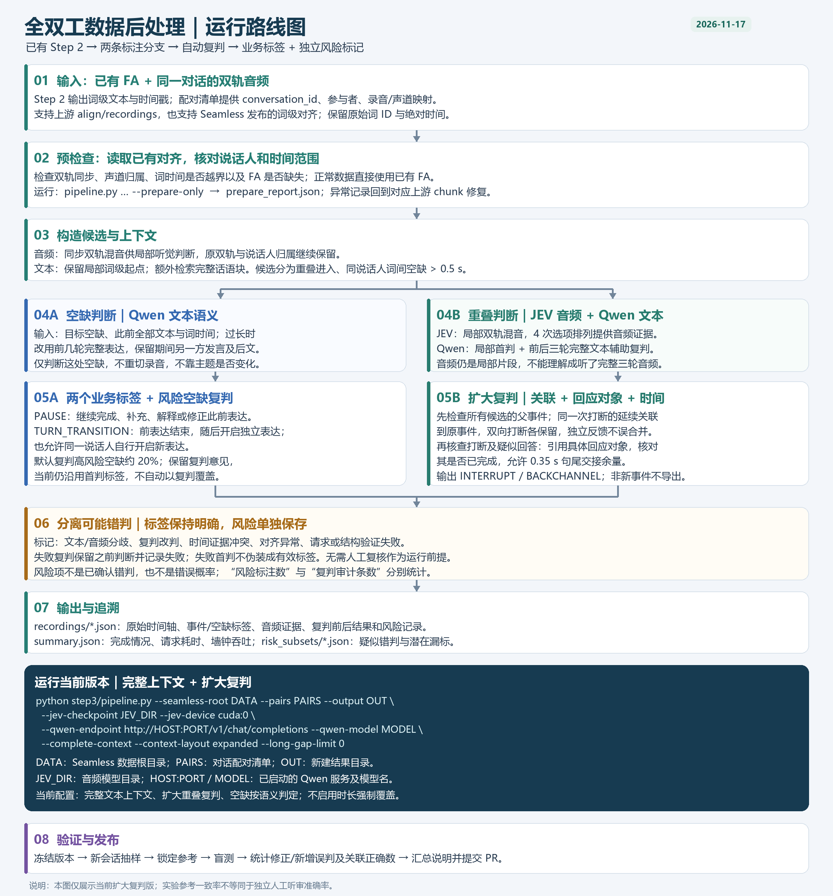

# 完整上下文与重叠事件复判

本次新增两个可选复判入口，默认运行仍保留原发布版。没有接入 SFT/DPO 权重。
此处的 `NEITHER` 表示候选不是一个新的重叠事件，不是新增的空缺标签。
空缺业务标签仍只有 `PAUSE`、`TURN_TRANSITION`。



## 选择运行方式

| 方式 | 追加参数 | 用途 |
|---|---|---|
| 原发布版 | 无 | 保留原局部文本、混音音频和规则路径 |
| 原有定向复判 | `--complete-context --context-layout review` | 复核少数句尾回答，恢复有证据的短反馈 |
| 扩大复判版 | `--complete-context --context-layout expanded` | 检查所有候选的事件关联，额外核查正常回答误报 |

`full`、`anchored`、`stateful` 是保留的消融实验入口，不代表推荐配置。
直接扩展上下文不一定提高准确性。`--complete-context` 同时扩展空缺文本输入；
本次 BI 测试仅评估重叠事件，不能据此推断空缺准确率提高。

```bash
python step3/pipeline.py \
  --seamless-root /path/to/seamless_fd \
  --pairs /path/to/pairs.jsonl --output /path/to/new-run \
  --jev-checkpoint /path/to/DuplexJev-32B-Para --jev-device cuda:0 \
  --qwen-endpoint http://127.0.0.1:18771/v1/chat/completions \
  --qwen-model YOUR_SERVED_MODEL_NAME \
  --complete-context --context-layout expanded --long-gap-limit 0
```

也可沿用 README 中的 `--align-recordings`，直接对接 Step 2 的 FA。
使用新输出目录，保留原始对话 ID、词 ID、绝对时间和同步双轨。
实验服务提供 32,768 token 上下文；长 BI 请求超出服务容量时会记录请求失败，
不以裁断文本或伪造标签冒充成功。服务器模型名是本地服务别名，不是性能保证。

## 扩大复判的具体步骤

1. **原版首判。** 候选仍来自词级 FA；双轨混音由 JEV 提供局部音频证据，Qwen
   做原有判断。不会因为文本检索范围变长而改动候选起点。
2. **原有定向复判。** 保留 `review` 的短反馈恢复和句尾回答检查，作为比较基线。
3. **整段事件关联复判。** Qwen 同时看到局部起点、前后完整对话块、已有判断和
   前一同说话人表达，为每个候选提出 KEEP/MERGE/DROP。所有候选均覆盖；
   同方向、时间先后、父事件是否存在以及功能是否一致必须通过验证。
4. **有约束地采用关联建议。** 已有反馈不因为整段重写而被删除或合并。
   允许把重复的打断关联到较早的同方向打断。仅在后续确有同次延续建议时，
   尝试恢复缺失的碎片化打断起点。独立反馈和双向打断不能合成同一个事件。
5. **逐个核查疑似普通回答。** 检查所有保留的打断，以及邻近有问句的反馈。
   模型必须指出具体回应对象或自身延续，并引用输入中的原文，不能只凭“赞同”
   就改判。引用不匹配、输出截断等会重试；仍失败则保留之前判断并记录风险。
6. **核对时间证据。** 对方仍在当前话语内时保留已有反馈。将打断撤销为普通回答时，
   被引用的对方内容必须已经出现在介入时刻之前，允许 0.35 秒句尾交接余量。
   这个值是工程保护条件，不是普适的人类话轮边界。撤销根事件时同时处理其延续，
   不能留下指向已删除事件的链接。
7. **导出业务标签和风险。** 输出最终事件及复判前后记录。改变标签、文本音频冲突、
   复判失败等进入质量记录；风险不代表已确认错误，也不是校准后的错误概率。

每个窗口还保存 `response_audits`、`expanded_review_attempts`、`graph_changes` 和
`graph_proposal_error`。被时间证据阻止的改判记为 `semantic_review_timing_conflict`。
`risk_summary.flagged_annotations` 只统计实际事件/空缺，复判审计记录另计
`review_audit_items`，避免同一标注重复计数。上下文窗口内但非当前核心起点的审计
不重复计入当前窗口的风险项。

JEV 听到的是目标附近的双轨混音，Qwen 看到的是扩展文本。没有宣称模型听取了
完整三轮音频。检索的“轮”由完整话语块近似，不是真值话轮；详见
[CONTEXT_POLICY.md](CONTEXT_POLICY.md)。

## 验证口径

评估同时检查：候选是否为一个新事件、普通回答误报、同一打断的延续链接、
同一反馈的连续部分、独立反馈是否被误合并。删除一个延续候选可以得到正确的
“非新事件”标签，但若没有归入父事件，关联检查仍不通过。

参考由 Codex 在查看新样本预测前依据完整文本与 FA 时间锁定，并记录 SHA-256。
这属于自动语义参考一致率，不是独立人工听审准确率。原 30 段用于开发；
冻结之后另抽 30 个未使用会话，预测不能读取参考标签。
样本按易错场景分层抽取，不代表数据集自然比例；参考质量问题在预测前单列，
全部样本仍保留在主结果中。

实测结果见 [BI_REVIEW_RESULTS.md](BI_REVIEW_RESULTS.md)。
音频、完整转录、私有机器路径、训练权重和连接凭据不随仓库发布。
汇总结果与代码指纹可以公开，逐项原始记录保存在实验目录。

## 用自己的锁定参考复核

推理完成后在独立评估进程运行：

```bash
python step3/evaluate_locked_bi.py \
  --reference /path/to/reference_locked.json --lock /path/to/reference_lock.json \
  --before /path/to/baseline.json --after /path/to/optimized.json \
  --output /path/to/evaluation.json
```

`reference_locked.json` 的 `cases` 按窗口编号索引，每个窗口包含 `events`
（`candidate_id`、`label`、可选 `function`）和 `structure_checks`
（`kind`、`parent`、`child`、`label`）。`kind` 支持 `same_interruption`、
`same_feedback`、`separate_feedback`。`reference_lock.json` 的 `sha256`
是参考文件原始字节的 SHA-256。预测也按相同窗口编号索引，使用分类器返回的
`status` 与 `events`。失败窗口保留在分母，不能自动当成 `NEITHER`。
生产输出可按窗口整理成该格式；评估程序不会调用模型，也不会生成参考标签。
